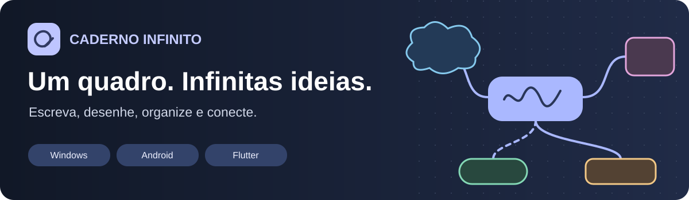
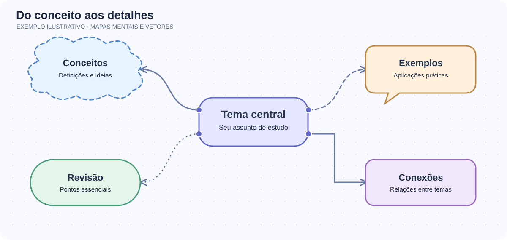
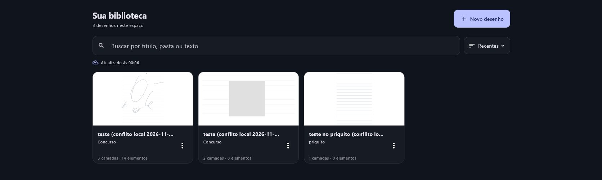
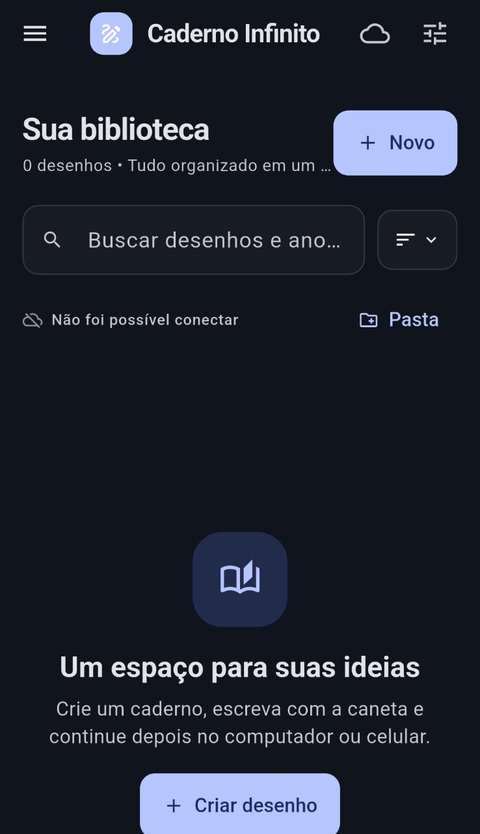
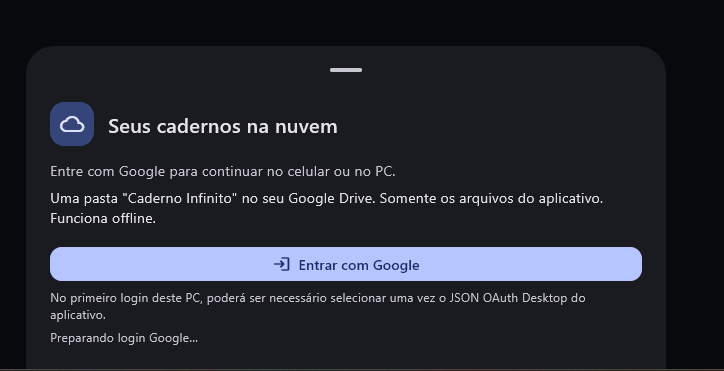
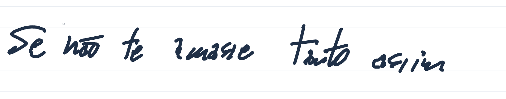

<div align="center">
  

  # Caderno Infinito

  **Seu espaço digital para escrever, desenhar, estudar e organizar ideias sem os limites de uma página.**

  
  
  
  
  

  [Recursos](#recursos) · [Imagens](#imagens) · [Compilação](#compilação) · [Sincronização](#sincronização-com-google-drive)
</div>

## Sobre o projeto

O **Caderno Infinito** é um aplicativo de anotações digitais, desenho vetorial e organização visual desenvolvido em Flutter e Dart para Windows e Android. Combina a liberdade da escrita à mão com ferramentas de edição, geometria e criação de mapas mentais, em uma interface limpa e adaptada a computadores, celulares e tablets.

Ideal para estudantes, professores, concurseiros e pessoas que preferem aprender visualmente. Crie resumos, esquemas, diagramas, aulas, rascunhos e projetos em um quadro de extensão livre, com zoom, navegação e rotação. Trabalhe localmente e, quando configurada a integração com Google Drive, sincronize seus cadernos entre dispositivos.

## Recursos

### Escrita e desenho digital

- Quadro infinito, zoom, panorâmica e rotação da área de trabalho.
- 44 ferramentas no catálogo, incluindo canetas, lápis, marcador, borracha, formas, seleção e medição.
- Estabilização automática ao concluir o traço, com intensidade ajustável de 0 a 200%.
- Suporte à pressão da caneta quando disponibilizada pelo dispositivo.
- Cores, espessura, opacidade, predefinições de pincéis e diferentes tipos de papel e grade.
- Menu radial configurável, gestos e atalhos de teclado.

### Mapas mentais, diagramas e vetores

- Nuvens, balões de fala, caixas arredondadas, cápsulas, hexágonos e formas geométricas.
- Conectores retos, curvos e em cotovelo, vinculados às formas para acompanhar seus movimentos.
- Linhas contínuas, tracejadas, pontilhadas e traço-ponto, com opções de setas.
- Curvas vetoriais Bézier com extremos e pontos de controle editáveis.
- Modelo radial com quatro ramos, guias de alinhamento e encaixe.
- Seleção por laço, agrupamento, duplicação, rotação e redimensionamento de elementos.



*Exemplo ilustrativo de mapa mental, não captura da interface. Textos e escrita são objetos independentes; agrupe-os às formas para movê-los juntos.*

### Texto, imagens e documentos

- Digitação diretamente no quadro, com tamanho de fonte definido antes da escrita.
- Negrito, itálico, sublinhado, tachado, destaque, tamanho e cor por trecho selecionado.
- Importação de imagens e PDF para anotações.
- Colagem de imagens da área de transferência do Windows, inclusive capturas de tela, usando `Ctrl+V`.
- Exportação em PDF comum, PNG e SVG; há também uma modalidade de PDF vetorial com restrições de conteúdo.

### Biblioteca e produtividade

- Organização em cadernos e pastas, pesquisa e miniaturas.
- Seleção múltipla, exclusão em lote e Lixeira com restauração.
- Camadas com visibilidade, bloqueio, opacidade e reordenação.
- Desfazer e refazer, salvamento local, histórico de versões e backup.
- Minimapa, marcadores de posição, busca de texto digitado e modo de tela cheia.
- Temas claro e escuro e central de ações.

## Imagens

### Biblioteca no Windows



*Captura real de uma versão anterior, recortada para preservar a privacidade da conta.*

### Android e integração com a nuvem

<table>
<tr><td width="40%" align="center"></td><td width="60%" align="center"></td></tr>
<tr><td align="center">Biblioteca Android — captura real anterior, sem conexão.</td><td align="center">Tela real de conexão Google — versão anterior.</td></tr>
</table>

### Escrita à mão



*Amostra de escrita enviada durante o desenvolvimento, anterior ao filtro de 200%. Não representa um teste da versão atual.*

## Atalhos de teclado

| Atalho | Ação | Atalho | Ação |
|---|---|---|---|
| `B` | Caneta | `E` | Borracha |
| `M` | Marcador | `T` | Texto |
| `V` | Seleção | `Q` | Laço |
| `H` | Mover tela | `R` | Retângulo |
| `Shift+1` | Nuvem | `Shift+2` | Balão de fala |
| `Shift+6` | Reta tracejada | `Shift+7` | Curva vetorial |
| `Shift+8` | Conector curvo | `Shift+9` | Conector em cotovelo |
| `Ctrl+Z` | Desfazer | `Ctrl+Y` | Refazer |
| `Ctrl+V` | Colar objetos/imagens | `Ctrl+S` | Salvar |
| `F11` | Tela cheia | `F2` | Guia de atalhos |

Durante a edição de texto, os atalhos de letras simples são desativados para permitir a digitação normal.

## Compilação

### Requisitos

- Windows, Flutter SDK com Dart compatível com `>=3.9.0 <4.0.0`, Git e PowerShell.
- Visual Studio com a carga de trabalho de desenvolvimento de desktop com C++ para o EXE.
- Android Studio, Android SDK e JDK para o APK.

Obtenha o código-fonte do projeto e extraia-o em uma pasta local. Os scripts incluídos preparam as pastas nativas quando necessário e trabalham em uma pasta curta no disco C:, evitando problemas de caminho e links simbólicos em pastas sincronizadas.

### Verificar e gerar os aplicativos

```powershell
.\04_VERIFICAR_NO_C.cmd
.\01_COMPILAR_TUDO_NO_C.cmd
```

Também é possível compilar apenas um destino:

```powershell
.\02_COMPILAR_EXE_NO_C.cmd
.\03_COMPILAR_APK_NO_C.cmd
```

Na versão 1.0.8, os artefatos ficam em `%USERPROFILE%\ci108_full\dist`:

| Plataforma | Saída |
|---|---|
| Windows | `CadernoInfinito_Windows\caderno_infinito.exe` |
| Android | `CadernoInfinito_Android.apk` |

Distribua a pasta Windows completa, incluindo as DLLs e a pasta `data`. Faça backup dos cadernos antes de atualizar.

## Sincronização com Google Drive

O aplicativo salva desenhos localmente no formato editável `.ci.json`. A integração opcional com Google Drive mantém uma pasta **Caderno Infinito** na conta do usuário, com sincronização periódica e ao sair do editor. Não é uma ferramenta de coedição em tempo real.

Para habilitar o login, configure a API Google Drive, o consentimento OAuth e os clientes Desktop, Web e Android no mesmo projeto Google Cloud. O cliente Android deve corresponder ao pacote `br.cadernonuvem.caderno_infinito` e ao SHA-1 da assinatura utilizada. Consulte `CONEXAO_GOOGLE.md` e as instruções da versão para detalhes.

> Nunca publique tokens, chaves de assinatura, arquivos locais de credenciais ou backups pessoais no repositório. O código-fonte não inclui credenciais OAuth de produção.

## Tecnologias

| Tecnologia | Finalidade |
|---|---|
| Flutter / Dart | Interface multiplataforma e lógica do editor |
| CustomPainter / Canvas | Renderização de traços, formas e vetores |
| JSON | Documentos editáveis e persistência de propriedades |
| Google Sign-In / Drive API | Autenticação e sincronização opcional |
| PDFx / PDF / Printing | Importação, exportação e impressão |
| Flutter Test | Testes automatizados |

## Estado do desenvolvimento

Versão do código-fonte: **1.0.8**. O projeto está em desenvolvimento ativo. A versão 0.9.8 teve análise, 97 testes e builds Windows e Android confirmados no computador do desenvolvedor. A versão 1.0.8 corrige a importação de `Rect` nos testes de mapas mentais; sua análise, execução dos testes e compilação ainda precisam de confirmação.

Limitações atuais: conectores não desviam automaticamente de obstáculos; a busca textual não reconhece escrita manual (OCR); a sincronização depende da configuração OAuth; a exportação PDF vetorial tem restrições para texto e novas formas. Consulte o histórico de mudanças para informações por versão.

## Contribuições

Sugestões, relatos de erros e propostas de melhorias são bem-vindos. Ao relatar um problema, inclua a versão do aplicativo, o sistema operacional, passos para reproduzir e o resultado esperado. Evite compartilhar credenciais ou documentos pessoais.

---

<div align="center"><strong>Caderno Infinito</strong> — organize seu conhecimento do seu jeito.</div>
